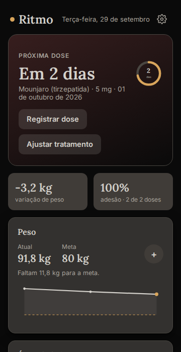
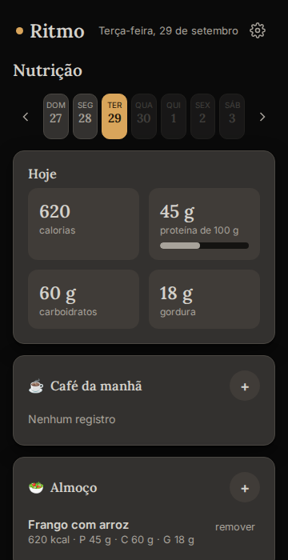

# Ritmo

App para quem faz tratamento com GLP-1 (Ozempic, Mounjaro, Wegovy etc.) acompanhar doses, peso, sintomas, água e alimentação. No fim, ele gera um relatório para levar ao médico.

É um **PWA offline-first**: funciona sem internet, pode ser instalado no celular como app e guarda os dados **só no aparelho**, com backup em arquivo.

**Demo:** `https://SEU-USUARIO.github.io/ritmo/`

<p>
  
  
</p>

**Stack:** React 18 · TypeScript · Redux Toolkit · Vite · PWA (Workbox) · IndexedDB · Vitest + Testing Library · ESLint · GitHub Actions + GitHub Pages

## Funcionalidades

- **Próxima dose:** contagem regressiva com anel de progresso e alerta de atraso. A adesão é calculada como doses registradas ÷ doses esperadas.
- **Doses:** registro com local de aplicação e notas.
- **Peso e medidas:** gráfico de evolução com linha da meta, cintura e quadril.
- **Sintomas:** vários por registro, com intensidade de 1 a 5.
- **Água:** copos de 250 ml, quantidade livre, meta diária e gráfico dos últimos 7 dias.
- **Nutrição:** refeições por tipo, calorias e macros, meta de proteína com barra de progresso, e navegação entre semanas.
- **Relatório para o médico:** 30, 60 ou 90 dias, com impressão ou PDF em layout próprio para papel.
- **Backup:** exporta e importa um JSON e migra automaticamente os dados da versão antiga (arquivo HTML único).

## Arquitetura

```
src/
  domain/        regras puras, sem React (fáceis de testar)
    dates.ts     datas no horário local
    dose.ts      próxima dose e adesão
    report.ts    agregações do relatório
    backup.ts    exportar / importar / migrar, com validação
  store/         Redux Toolkit
    dataSlice    dados do usuário (persistidos)
    uiSlice      aba, dia selecionado, período do relatório (não persistidos)
    persistence  IndexedDB com debounce e migração do localStorage antigo
    selectors    listas ordenadas memoizadas (createSelector)
  components/    Modal acessível, ChipGroup, gráficos SVG, copos de água...
  forms/         modais de cadastro com validação
  views/         uma tela por aba
```

### Decisões

- **Sem back-end de propósito.** São dados de saúde, e ficar só no aparelho é o mais simples e o mais privado. O preço é o risco de perder tudo, e por isso existe o backup em arquivo.
- **IndexedDB em vez de localStorage.** Tem mais espaço, funciona de forma assíncrona e é menos sujeito a ser apagado pelo navegador.
- **"Última dose" é derivada, não gravada.** É a data mais recente entre as doses registradas e a informada na configuração. Remover uma dose recalcula a próxima sozinho.
- **Datas no horário local.** A versão original usava `toISOString()`, que é UTC. No Brasil, das 21h à meia-noite o app achava que já era o dia seguinte. Tem teste cobrindo esse caso.
- **Acessibilidade:**
  - chips e copos são `<button aria-pressed>`;
  - modais têm `role="dialog"`, fecham com Esc e mantêm o foco dentro;
  - cada label está ligado ao seu campo;
  - gráficos têm `aria-label`;
  - o zoom do celular não é bloqueado.

## Rodando

```bash
npm install
npm run dev        # http://localhost:5173
npm test           # 25 testes (domínio, store, persistência e interface)
npm run lint
npm run build      # gera dist/ com service worker
```

## Deploy

O workflow `.github/workflows/deploy.yml` roda lint, testes e build a cada push. Na branch `main`, ele publica no GitHub Pages.

Para ativar, vá em **Settings → Pages → Source: GitHub Actions**.

## Próximos passos

- Estimar os macros por foto do prato com IA. Isso precisa de um back-end pequeno para não expor a chave da API.
- Lembrete de dose por notificação.
- Sincronização opcional entre aparelhos.

## Aviso

O Ritmo é uma ferramenta de registro pessoal e **não substitui orientação médica**.

## Autor

Ademar C. Neto
